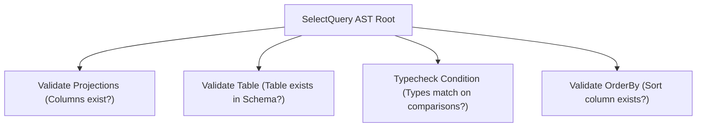

# Parse Tree and Abstract Syntax Tree (AST) Walkthroughs

**Project:** Mini SQL Compiler  
**Course:** 3rd Year CSE — Compiler Design Mini-Project  
**Document Version:** 1.0.0  
**Status:** Approved Formal Specification  

---

## 1. Concrete Parse Tree (CST) vs. Abstract Syntax Tree (AST)

In compiler design, understanding the structural transformation from a **Concrete Syntax Tree (CST)** to an **Abstract Syntax Tree (AST)** is fundamental.

| Feature / Metric | Concrete Parse Tree (CST) | Abstract Syntax Tree (AST) |
| :--- | :--- | :--- |
| **Formal Definition** | Direct graphical representation of the formal grammar derivations. Every non-terminal appears as an interior node. | Condensed, syntax-abstracted tree containing only essential semantic constructs and operands. |
| **Punctuation & Delimiters** | Explicitly retains all punctuation, keywords, parentheses, and commas (e.g., `,`, `;`, `(`, `)`). | Punctuation is discarded. Structure is implicitly represented by the parent-child relationship of tree nodes. |
| **Grammar Artifacts** | Contains intermediate non-terminals introduced by grammar transformations (e.g., `<OrExprTail>`, `<ColumnListTail>`). | Eliminates grammar transformation artifacts, collapsing lists directly into arrays of items. |
| **Size & Memory** | Extremely verbose and memory-heavy. Multiple redundant single-child wrapper nodes. | Compact, streamlined, and optimized for subsequent semantic analysis and code generation/execution. |
| **Compiler Role** | Produced conceptually by the parsing algorithm during token consumption. | The primary intermediate data structure passed to the Semantic Analyzer and Query Engine. |

---

## 2. Walkthrough 1: Projection & Source Query

### 2.1 Query Statement
```sql
SELECT name, age FROM students;
```

### 2.2 Leftmost Grammar Derivation
Using the transformed grammar $G'$:
```text
<Query>
=> <SelectClause> <FromClause> <OptWhereClause> <OptOrderByClause> <OptSemicolon>
=> 'SELECT' <SelectList> <FromClause> <OptWhereClause> <OptOrderByClause> <OptSemicolon>
=> 'SELECT' <ColumnList> <FromClause> <OptWhereClause> <OptOrderByClause> <OptSemicolon>
=> 'SELECT' IDENTIFIER(name) <ColumnListTail> <FromClause> <OptWhereClause> <OptOrderByClause> <OptSemicolon>
=> 'SELECT' IDENTIFIER(name) ',' <ColumnList> <FromClause> <OptWhereClause> <OptOrderByClause> <OptSemicolon>
=> 'SELECT' IDENTIFIER(name) ',' IDENTIFIER(age) <ColumnListTail> <FromClause> <OptWhereClause> <OptOrderByClause> <OptSemicolon>
=> 'SELECT' IDENTIFIER(name) ',' IDENTIFIER(age) ε <FromClause> <OptWhereClause> <OptOrderByClause> <OptSemicolon>
=> 'SELECT' IDENTIFIER(name) ',' IDENTIFIER(age) 'FROM' IDENTIFIER(students) <OptWhereClause> <OptOrderByClause> <OptSemicolon>
=> 'SELECT' IDENTIFIER(name) ',' IDENTIFIER(age) 'FROM' IDENTIFIER(students) ε <OptOrderByClause> <OptSemicolon>
=> 'SELECT' IDENTIFIER(name) ',' IDENTIFIER(age) 'FROM' IDENTIFIER(students) ε ε <OptSemicolon>
=> 'SELECT' name , age FROM students ;
```

---

### 2.3 Concrete Parse Tree (CST)
```text
                       <Query>
        ┌─────────────────┼──────────────────┬──────────────────┐
        │                 │                  │                  │
 <SelectClause>     <FromClause>      <OptWhereClause>   <OptSemicolon>
    ┌───┴───┐          ┌───┴────┐            │                  │
'SELECT' <SelectList> 'FROM'  IDENTIFIER     ε                 ';'
            │                 (students)
       <ColumnList>
     ┌──────┴──────────────┐
 IDENTIFIER         <ColumnListTail>
  (name)               ┌───┴─────────┐
                      ','       <ColumnList>
                                 ┌───┴──────────────┐
                             IDENTIFIER      <ColumnListTail>
                               (age)                │
                                                    ε
```

---

### 2.4 Abstract Syntax Tree (AST)
```text
                    SelectQuery
                   ┌─────┴─────┐
             Projections     FromTable
            ┌─────┴─────┐        │
        Identifier  Identifier "students"
         ("name")    ("age")
```

#### JSON Representation of AST:
```json
{
  "type": "SelectQuery",
  "projections": [
    { "type": "Identifier", "name": "name" },
    { "type": "Identifier", "name": "age" }
  ],
  "from": { "type": "Table", "name": "students" },
  "where": null,
  "orderBy": null
}
```

---

## 3. Walkthrough 2: Filtered & Sorted Query

### 3.1 Query Statement
```sql
SELECT id FROM employees WHERE age >= 21 AND salary > 50000 ORDER BY salary DESC;
```

### 3.2 Concrete Parse Tree (CST) Structure
```text
                                        <Query>
      ┌──────────────┬─────────────────────┼──────────────────────┬──────────────────────┐
<SelectClause> <FromClause>          <WhereClause>          <OrderByClause>        <OptSemicolon>
      │              │               ┌─────┴─────┐            ┌───┴───┐                  │
 'SELECT' id    'FROM' employees  'WHERE'     <OrExpr>      'ORDER'  'BY' <OrderByList> ';'
                                                 │                             │
                                             <AndExpr>                  <OrderByItem>
                                       ┌─────────┴─────────┐              ┌────┴────┐
                                 <AndExpr>    'AND' <ComparisonExpr>   salary     'DESC'
                                     │                     │
                             <ComparisonExpr>      salary > 50000
                                     │
                                 age >= 21
```

---

### 3.3 Abstract Syntax Tree (AST) Structure
In the AST, intermediate non-terminal chains (`<OrExpr>`, `<AndExpr>`, `<ComparisonExpr>`) are simplified into clean binary operator nodes:

```text
                                 SelectQuery
        ┌──────────────┬──────────────┴──────────────┬────────────────┐
  Projections      FromTable                       Where           OrderBy
       │               │                             │                │
   [ "id" ]     "employees"                     BinaryExpr       OrderByItem
                                                (op: "AND")     ┌─────┴─────┐
                                           ┌─────────┴─────────┐  column:   direction:
                                       BinaryExpr          BinaryExpr   "salary"   "DESC"
                                       (op: ">=")          (op: ">")
                                      ┌────┴────┐         ┌────┴────┐
                                    Column   Literal    Column   Literal
                                    ("age")   (21)     ("salary") (50000)
```

#### JSON Representation of AST:
```json
{
  "type": "SelectQuery",
  "projections": [
    { "type": "Identifier", "name": "id" }
  ],
  "from": { "type": "Table", "name": "employees" },
  "where": {
    "type": "BinaryExpr",
    "operator": "AND",
    "left": {
      "type": "BinaryExpr",
      "operator": ">=",
      "left": { "type": "Identifier", "name": "age" },
      "right": { "type": "IntegerLiteral", "value": 21 }
    },
    "right": {
      "type": "BinaryExpr",
      "operator": ">",
      "left": { "type": "Identifier", "name": "salary" },
      "right": { "type": "IntegerLiteral", "value": 50000 }
    }
  },
  "orderBy": [
    {
      "column": { "type": "Identifier", "name": "salary" },
      "direction": "DESC"
    }
  ]
}
```

---

## 4. AST Traversal: Visitor Pattern for Semantic Analysis

Once the parser builds the AST, subsequent compiler phases (such as semantic checking and query plan execution) traverse the AST using the **Visitor Pattern**:



1. **`visit_select_query(node)`**: Inspects the projection list and registers expected result columns.
2. **`visit_from_table(node)`**: Verifies that the referenced table exists in the schema symbol table.
3. **`visit_binary_expr(node)`**: Recursively checks that comparison operands are type-compatible (e.g. integer compared to integer, not string compared to integer).
4. **`visit_order_by(node)`**: Verifies that the order-by target column is present in the table schema.

---

## 5. Viva Voce Whiteboard Questions

* **Q: Why does the compiler throw away commas and semicolons when creating the AST?**  
  * **Answer:** Punctuation tokens are delimiters required only during lexical and syntax analysis to separate items unambiguously in source text. Once the parser determines grammatical hierarchy and groups items into tree child nodes or lists, punctuation conveys no semantic meaning and is discarded to save memory and simplify AST evaluation.
* **Q: Draw the AST for `WHERE age > 18 AND status = 'active'`.**  
  * **Answer:** An `AND` binary expression node at the root of the condition subtree, with its left child being a `>` binary node (`age`, `18`), and its right child being a `=` binary node (`status`, `'active'`).
* **Q: How does operator precedence manifest in the AST?**  
  * **Answer:** Operators with higher precedence are positioned **deeper** in the syntax tree (further from the root). This ensures that when the tree is evaluated bottom-up (post-order traversal), higher precedence expressions evaluate first.
